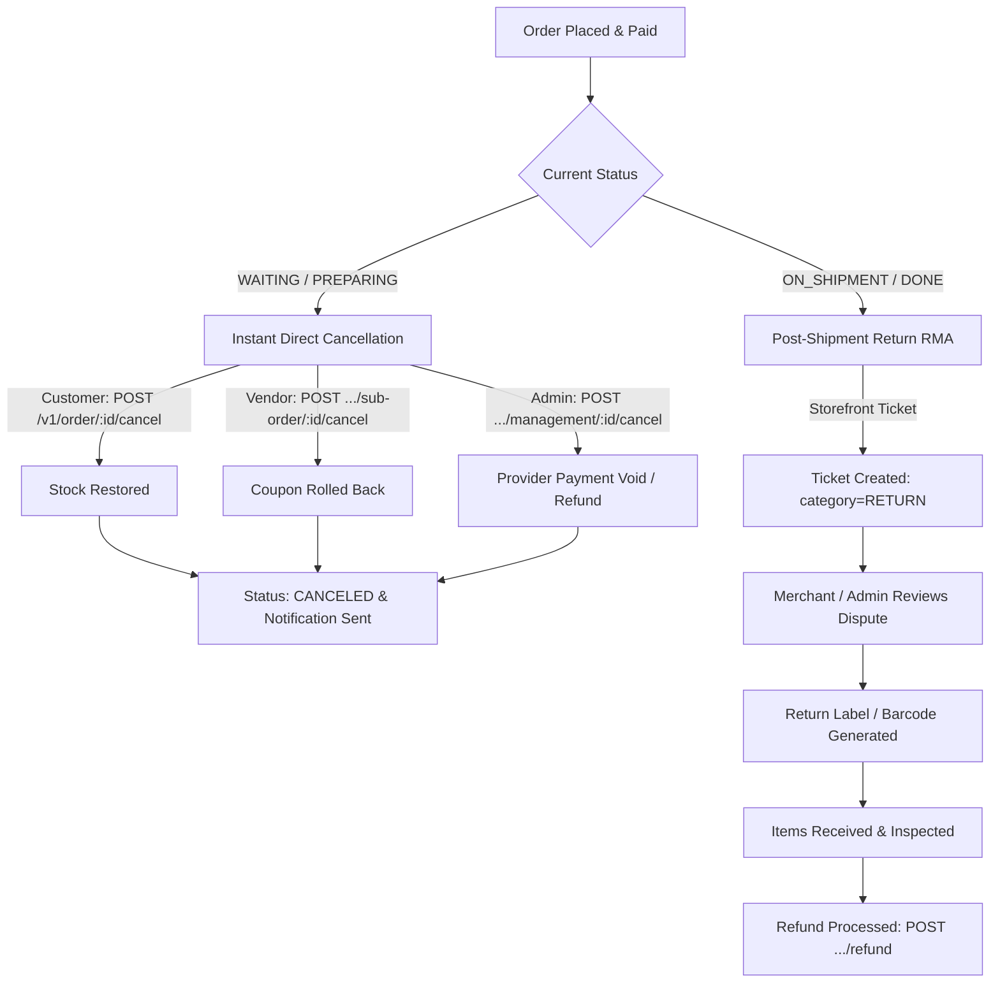

# Order API

The Order API orchestrates the finalization of purchases, participant registration for ticketed items, credit card installments, customer purchase histories, and merchant vendor sub-order tracking.

---

## 1. Storefront & Customer Endpoints

### Create Order (Checkout)
Finalizes checkout using an existing basket, delivery addresses, and payment credentials.

* **Endpoint:** `POST /v1/order`
* **Headers:** `x-avci-client: <client_key>`, `Authorization: Bearer <token>`
* **Body Fields:**
  | Field | Type | Required | Description |
  | :--- | :--- | :--- | :--- |
  | `basketId` | `string` | Yes | Prepared basket identifier. |
  | `paymentMethod` | `string` | Yes | `CREDIT_CARD`, `BANK_TRANSFER`, `WALLET`, etc. |
  | `addresses` | `object` | Yes | `{ shipmentAddressId, billingAddressId }` |
  | `card` | `object` | No* | Credit card payload (if paying by direct card). |
  | `cardId` | `string` | No* | Stored card token identifier (for one-click checkout). |
  | `installment` | `number` | No | Installment count (e.g., `1`, `3`, `6`, `12`). |
  | `participants` | `array` | Conditional | **Required if the basket contains ticket items (`event` or `route`).** |

#### Participant Information for Ticket Items
When the basket contains **event** or **route** items, attendee information must be provided for each seat slot:
```json
{
  "basketId": "bskt_987654321",
  "paymentMethod": "CREDIT_CARD",
  "addresses": {
    "shipmentAddressId": "6735c0001112223334445556",
    "billingAddressId": "6735c0001112223334445556"
  },
  "participants": [
    {
      "basketItemId": "item_event_slot_1",
      "name": "Ahmet Yılmaz",
      "email": "ahmet@example.com",
      "phone": "+905551112233"
    },
    {
      "basketItemId": "item_route_slot_2",
      "name": "Zeynep Kaya",
      "email": "zeynep@example.com"
    }
  ]
}
```

> [!NOTE]
> For **route** tickets, attendee details are automatically registered into the parent route and all sub-events contained within that route inside a single atomic database transaction.

---

### List Customer Orders
Returns the authenticated customer's order history.

* **Endpoint:** `GET /v1/order`
* **Query Parameters:** `page`, `limit`, `status`
* **Headers:** `x-avci-client: <client_key>`, `Authorization: Bearer <token>`

---

### Get Customer Order Details
Fetches detailed tracking, invoice, agreement, and item records for a single customer order.

* **Endpoint:** `GET /v1/order/:orderId`
* **Headers:** `x-avci-client: <client_key>`, `Authorization: Bearer <token>`

---

### Query Installment Options
Retrieves installment matrix and bank rates based on the customer's credit card BIN number.

* **Endpoint:** `POST /v1/order/installment`
* **Headers:** `x-avci-client: <client_key>`
* **Body:**
  ```json
  {
    "binNumber": "540667",
    "price": 1500.00
  }
  ```

---

### Cancel Order (Customer Pre-Shipment Cancellation)
Directly cancels an order before it has been shipped (`WAITING`, `PREPARING`, or `PENDING_PAYMENT`).
Instantly executes product stock restoration (`restoreStockCounts`), rolls back coupon usage (`rollbackCouponUsage`), voids or refunds payment via the active payment provider, and notifies the merchant.

* **Endpoint:** `POST /v1/order/:orderId/cancel`
* **Headers:** `x-avci-client: <client_key>`, `Authorization: Bearer <customer_token>`
* **Rules & Constraints:**
  - Customers can only cancel orders belonging to their own user account.
  - Allowed statuses: `WAITING`, `PREPARING`, `PENDING_PAYMENT`.
  - Once an order or any assigned sub-order is marked `ON_SHIPMENT` or `DONE`, direct cancellation is blocked and the customer must submit an RMA return request.
* **Body:**
  ```json
  {
    "reason": "Changed my mind / wrong size selected",
    "reasonCode": "BUYER_CANCELLED"
  }
  ```
* **Response (200 OK):**
  ```json
  {
    "status": "success",
    "message": "Order canceled successfully",
    "data": {
      "orderId": "ORD-12345",
      "status": "CANCELED",
      "refundResult": { "status": "success", "type": "VOID", "amount": 1500.00 }
    }
  }
  ```

---

### Saved Payment Cards (with Primary / Default Card)
Manages stored credit cards with full PCI-DSS compliance. AVCI CMS never stores credit card PAN, CVV, or expiry dates; card tokens are maintained by the PCI-DSS certified payment provider (e.g. Iyzico, Stripe), and the customer's preferred primary card token is tracked securely on their account.

* **List Saved Cards:** `GET /v1/order/saved-cards`
  - Returns stored cards enriched with `isPrimary: boolean`.
  - The customer's primary card is automatically sorted to the top of the list.
* **Store New Card:** `POST /v1/order/saved-cards`
  - Accepts card details and optional `"isPrimary": true`.
  - If it is the customer's first saved card, it is automatically marked as primary.
* **Delete Saved Card:** `DELETE /v1/order/saved-cards/:id`
  - Removes the card token from the provider.
  - If the deleted card was primary, the next available card is promoted to primary.
* **Set Primary / Default Card:** `PUT /v1/order/saved-cards/:id/primary`
  - Validates ownership and sets the card token as the default payment method for future 1-click checkouts.
  - Returns the refreshed list of cards with updated `isPrimary` flags.

---

## 2. Vendor / Merchant Isolated Endpoints

Vendors (`WORKSPACE_MERCHANT`) operate with strict row-level security. The platform verifies sub-order ownership (`validateSubOrderOwnership`), ensuring merchants can never access items, customer data, or financials outside their assigned sub-order.

### List Vendor Sub-Orders
Retrieves all sub-orders assigned to the authenticated merchant.

* **Endpoint:** `GET /v1/order/vendor`
* **Headers:** `Authorization: Bearer <merchant_token>`
* **Query Parameters:** `page`, `limit`, `status`

### Get Vendor Sub-Order Details
Retrieves detailed information for a single assigned sub-order.

* **Endpoint:** `GET /v1/order/vendor/:orderId`
* **Headers:** `Authorization: Bearer <merchant_token>`

### Cancel Assigned Sub-Order (Vendor / Merchant)
Allows a marketplace seller to cancel their own unfulfilled sub-order (e.g. out-of-stock item).
Restores stock for the merchant's items, calculates proportional customer refund via `RefundAllocationService`, issues the refund via the payment provider, and recalculates parent order status.

* **Endpoint:** `POST /v1/order/management/sub-order/:subOrderId/cancel`
* **Headers:** `Authorization: Bearer <merchant_token>`
* **Body:**
  ```json
  {
    "reason": "Item out of stock / Cannot fulfill",
    "autoRefund": true,
    "restoreStock": true,
    "isSellerFault": true
  }
  ```

---

## 3. Order Cancellations & RMA Returns Workflow

AVCI CMS distinguishes between **instant pre-shipment cancellations** and **post-shipment returns (RMA)**:



### Pre-Shipment Cancellation vs. Post-Shipment RMA:
1. **Pre-Shipment (Instant Automated Cancellation):**
   - Endpoints: `POST /v1/order/:orderId/cancel` (Customer), `POST /v1/order/management/:id/cancel` (Admin), `POST /v1/order/management/sub-order/:id/cancel` (Vendor).
   - Entirely automated: releases product reservations, recalculates coupon usage, and triggers payment void/refund without manual operator friction.
2. **Post-Shipment (RMA Return Flow):**
   - When items have left the warehouse (`ON_SHIPMENT`, `DONE`), the customer submits a return or dispute ticket via the [Ticket API](../communication/ticket.md).
   - Operators and sellers process the returned goods and initiate refunds using the refund endpoints.

