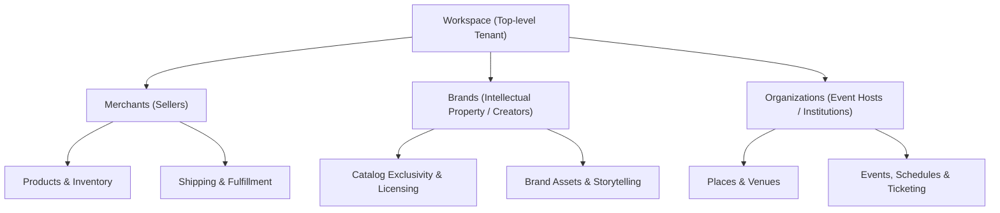

# AVCI CMS Guides

Welcome to the **AVCI CMS Platform Guides**. This documentation is tailored for tenant operations teams, workspace administrators, merchants, brand managers, and event organizers managing their digital business via the AVCI CMS control panel.

---

## Platform Overview

AVCI CMS is a multi-tenant platform architected to support complex business relationships within a single unified workspace. Whether you are operating a direct-to-consumer store, a multi-vendor marketplace, a licensed brand network, or an event venue collective, the platform structures your operations across distinct specialized entities:

---

## Navigating the Guides

The guides are organized into logical functional areas to help you locate what you need quickly:

### 1. [Getting Started & Setup](/guides/advanced/setup)
Step-by-step walkthrough of the **Onboarding Wizard** for every account type:
*   **Workspace Onboarding:** Choosing a blueprint, setting up initial branding, and connecting custom domains.
*   **Merchant Onboarding:** Completing business verification, store profile, and tax/payout configuration.
*   **Brand Onboarding:** Uploading trademarks, setting listing rules, and establishing brand identity.
*   **Organization Onboarding:** Registering corporate credentials and assigning venue administrators.

### 2. [Workspace Administration](/guides/workspace/overview)
For Workspace Owners and System Administrators:
*   **Domains:** Binding custom apex and sub-domains with automated SSL certification.
*   **Team & Security:** Inviting staff members and applying fine-grained RBAC permissions.
*   **Plans & Billing:** Managing your platform tier, invoicing history, and monitoring API/storage usage limits.
*   **System Settings:** Theme defaults, sales tax regulations, and currency configurations.

### 3. Entity Portals & Operations
Deep-dive guides for operating individual entity dashboards:
*   **[Merchant Portal](/guides/advanced/merchant):** Store visibility, operating hours, shipping carriers, order fulfillment, and settlement reporting.
*   **[Brand Portal](/guides/advanced/brand):** Brand profile management, catalog exclusivity controls, and authorized reseller whitelisting.
*   **[Organization Portal](/guides/advanced/organization):** Managing physical places/venues, hall configurations, and host policies.

### 4. Core Business Modules
Detailed guides for daily operational tasks:
*   **[Catalog & Merchandising](/guides/modules/catalog/products):** Adding products, managing multi-tier variants, stock amounts, campaigns, and discount coupons.
*   **[Events & Ticketing](/guides/modules/catalog/events):** Creating ticketed events, seating capacities, pricing tiers, and calendar synchronization.
*   **[Content Management](/guides/modules/contents):** Corporate pages, dynamic blog articles, media asset library, and multi-language dictionary.
*   **[Customer Relations](/guides/modules/communication/tickets):** Support ticket workflows, custom lead forms, and customer inquiries.
*   **[Hardware & Engagement Tools](/guides/modules/tools):** Dynamic QR code generation, NFC tag provisioning, and promotional carousel sliders.
*   **[Integrations App Store](/guides/integrations):** Connecting payment providers (Stripe, Iyzico), shipping carriers (Aras, Yurtiçi, MNG, DHL, UPS), ERP solutions, and analytics.

---

## Need Developer Documentation?

If you are a frontend developer or technical agency building custom storefronts, mobile apps, or custom integrations:
*   Visit the **[Public REST API Reference](/api)** for endpoint specifications and client authentication.
*   Check out the **[Developer SDK Hub](/sdk)** for the official TypeScript and Python SDKs.
