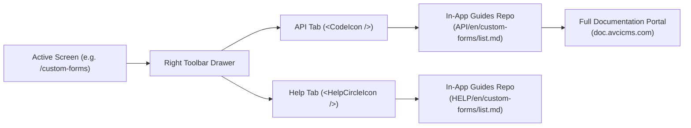

# In-App Contextual Guides

One of the defining productivity features of the AVCI CMS management console is the **In-App Contextual Guides** system, embedded in the **Right Toolbar** (`RightToolbar`).

Instead of navigating away from your active work or keeping dozens of browser tabs open with external documentation, AVCI CMS delivers screen-aware operational and API guidance directly inside a slide-over panel.



---

## 🎯 Key Capabilities & Benefits

### 1. Dual Mode: Help & API Reference
The Right Toolbar provides two specialized viewing modes tailored to different user roles:
* **Operational Help (`<HelpCircleIcon />`):** Designed for store operators, vendors (`WORKSPACE_MERCHANT`), brand managers, and editors. It explains module workflows, field meanings, validation rules, and lifecycle states (e.g., how to approve a merchant application or publish a scheduled blog post).
* **API Quick Reference (`<CodeIcon />`):** Tailored for developers, storefront integrators, and technical operators. It surfaces key REST endpoints, required headers (`x-avci-client`), query filters, payload examples, and status enumerations for the current module.

### 2. Screen-Aware Dynamic Resolution
The drawer automatically tracks your current location in the dashboard and fetches the corresponding documentation file without any manual searching:

| Active Route in Panel | Resolved Screen | Fetched Guide Path |
| :--- | :--- | :--- |
| `/products` | Products List | `guides/{type}/{locale}/products/list.md` |
| `/products/create` | Product Editor | `guides/{type}/{locale}/products/detail.md` |
| `/products/664a7.../edit` | Product Editor | `guides/{type}/{locale}/products/detail.md` |
| `/custom-forms` | Form Management | `guides/{type}/{locale}/custom-forms/list.md` |
| `/custom-forms/665.../answers` | Submissions Review | `guides/{type}/{locale}/custom-forms/detail.md` |
| `/merchants` | Merchants Directory | `guides/{type}/{locale}/merchants/list.md` |

### 3. Native Multilingual Support
The system automatically matches your active panel language preference (`tr` or `en`). If you switch your session language from English to Turkish, the Right Toolbar immediately loads the Turkish translation (`guides/{type}/tr/...`) in real time.

---

## 📦 The Public Guides Repository

AVCI CMS maintains an open, version-controlled repository dedicated solely to in-app documentation:

👉 **Official GitHub Repository:** [https://github.com/AVCI-CMS/in-app-guides](https://github.com/AVCI-CMS/in-app-guides)

### Structure of the Repository
```
in-app-guides/
├── API/                          # Developer REST endpoint references
│   ├── en/                       # English API guides
│   │   ├── products/             # [list.md, detail.md]
│   │   ├── custom-forms/
│   │   └── ...
│   └── tr/                       # Turkish API guides
└── HELP/                         # Merchant & operator user guides
    ├── en/                       # English operational guides
    └── tr/                       # Turkish operational guides
```

---

## ⚙️ Workspace Configuration & Custom Documentation

Every workspace can either use the official community guides or point to their own private GitHub repository to document custom internal business processes, SOPs (Standard Operating Procedures), or proprietary workflows.

### How to Configure:
1. Navigate to: **`Workspace > Settings > Appearance > Guides`**.
2. Verify that your **GitHub Integration** is connected in `Workspace > Integrations`.
3. Fill in your repository details:
   * **Repository Name:** `AVCI-CMS/in-app-guides` (Default) or your organization's fork (e.g., `acme-corp/cms-guides`).
   * **Branch:** `main` (or a dedicated review branch such as `staging`).
4. The panel will automatically fetch and cache Markdown files from your chosen repository.

:::tip Staging Documentation Changes
If you are introducing new internal SOPs, push your Markdown files to a `drafts` or `staging` branch first. Once reviewed and approved by your team, merge them into `main` to instantly update what operators see in their Right Toolbar.
:::

---

## ⚖️ In-App Guides vs. Developer Documentation Portal

It is essential to understand the architectural distinction between **In-App Guides** and the **Developer Documentation Portal**:

| Feature / Dimension | In-App Guides (`in-app-guides`) | Developer Portal (`doc.avcicms.com`) |
| :--- | :--- | :--- |
| **Location** | Slide-over drawer in CMS management panel | Independent public Docusaurus portal |
| **Primary Audience** | Active panel operators, vendors & on-the-fly developers | Storefront engineers, SDK integrators & architects |
| **Reading Format** | Scannable bullets, quick cheatsheets, status tables (≤100 lines) | Deep architectural essays, exhaustive JSON schemas, tutorials |
| **Code Examples** | Quick curl snippets & key query parameters | Complete TypeScript SDK (`@avci/sdk`) & Python SDK (`avcicms`) code |
| **Deep Link Reference** | Always links out to master documentation pages | Hosts the canonical master documentation |
