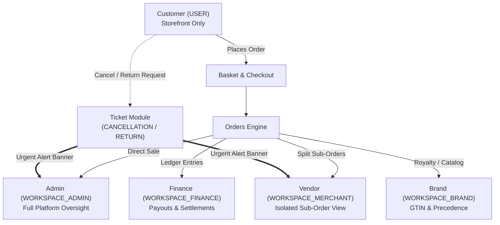

# Orders & Fulfillment Guide

**Menu Path:** `Finance & Logistics > Orders`

The **Orders** module is the central operational engine of the AVCI CMS ecosystem. It adapts dynamically based on your business model (**Single-Vendor eCommerce** vs. **Multi-Vendor Marketplace**) and the active user's permissions.

---

## 1. Persona & Profile Workflows

AVCI CMS strictly isolates user roles. Each profile interacts with orders and fulfillment through customized interfaces and security boundaries:

### Profile 1: Platform Super Admin & Operations Manager (`WORKSPACE_ADMIN` / `WORKSPACE_OWNER`)
* **Approval Queue:** Orders requiring manual verification appear in `WAITING` status with a prominent **"Approve"** button that advances the status to `PREPARING`.
* **Active Cancellation / Return Alert Banner:** If a customer submits a cancellation or return ticket via the Storefront, a red alert banner appears at the top of the order details:
  > *"Active Customer Cancellation / Return Ticket Found! Review the ticket before dispatching courier packages."*
* **Marketplace Sub-Order Supervision:** In Marketplace mode, admins inspect the master order and all individual sub-orders, verifying that each vendor fulfills their assigned items.
* **Financial Ledger Oversight:** In eCommerce mode, admins see store gross revenue, VAT, and shipping collected. In Marketplace mode, admins monitor commission splits and platform clearing.

### Profile 2: Marketplace Vendor (`WORKSPACE_MERCHANT`)
* **Isolated Sub-Order View:** When a vendor logs in, they only see their assigned sub-order (`/orders/[subOrderId]`). Vendors **never** have access to the master basket, other vendors' items, or global customer data.
* **Shipment Management (`OrderShipmentManager`):**
  - **Automatic Barcode:** Generates an integrated courier tracking number and printable shipping barcode with a single click.
  - **Manual Entry:** If permitted by workspace settings, allows manual entry of carrier and tracking codes.
* **Invoice Upload (`OrderInvoiceManager`):** Vendors upload the official PDF e-invoice (Sales Invoice, Return Invoice, or Cancel Invoice) and trigger automated email delivery to the customer.
* **RMA Return Approval:** When a return request is submitted, the vendor reviews the request and generates a reverse-logistics courier return code.

### Profile 3: Brand Owner (`WORKSPACE_BRAND`)
* **GTIN / Master Catalog Oversight:** Brands monitor which authorized merchants are selling their catalog items.
* **Shipping Precedence:** If a brand sets up custom courier contracts, the basket engine automatically gives precedence to the brand's shipping rules over the merchant's rules.

### Profile 4: Finance Specialist (`WORKSPACE_FINANCE`)
* **Payout Reconciliation:** Finance specialists monitor seller payout statuses (`PENDING`, `READY`, `PAID`, `CANCELED`).
* **Withholding & Commission Deductions:** Inspects withholding taxes (stopaj) and net payouts calculated per line item.
* **Master Wallet Overview:** Tracks platform transaction volume and automated clearing cycles (`/finance`).

### Profile 5: End User / Customer (`USER` - Storefront)
* **Zero Management Panel Access:** Customers **never** have access to the AVCI CMS management console.
* **Storefront Account Portal:** Customers track order statuses, view courier tracking links, and download event ticket PDFs / QR passes directly in the Storefront customer account.
* **Cancellation & Return Process (RMA via Tickets):**
  1. The customer selects an order item and clicks "Cancel Order" or "Request Return" on the Storefront.
  2. The system automatically creates a support ticket in the `ticket` module with category `CANCELLATION` or `RETURN`.
  3. The management panel displays the urgent alert banner, enabling the merchant or admin to approve the return and issue the reverse courier barcode.

### Profile 6: Storefront Integrator (`DEVELOPER`)
* Integrators use `@avci/sdk` or the Python SDK to interact with public endpoints (`/v1/basket` and `/v1/order`).
* **Management endpoints (`/management/*`) are strictly excluded from SDKs** and are reserved solely for the management frontend application.

---

## 2. Order Fulfillment Workflow

### Step 1: Order Intake & Verification
1. Order arrives in `WAITING` (if review required) or `PREPARING` status.
2. Operator or merchant reviews the **Summary Card**, customer notes, and the **Order Health Card** for automated diagnostic flags (e.g. payment mismatches or address discrepancies).

### Step 2: Attendees & Ticketed Items (Events & Routes)
- If the order contains ticketed items, the **Attendees Card** lists the full name, email, phone, and unique QR hash for every registered ticket holder.
- Route tickets register participants for all sequenced events within the tour automatically.

### Step 3: Courier Shipment Dispatch
1. Open the **Shipment Management** card.
2. Click **Generate Shipment Code** to create an automated barcode with the selected courier (e.g. Aras, Yurtiçi, MNG).
3. Print the courier shipping label and hand the package to the carrier.
4. The order status automatically updates to `ON_SHIPMENT`, and the customer receives an automated SMS and email tracking notification.

### Step 4: Invoice Upload & Customer Delivery
1. Open the **Invoice Management** card.
2. Select the invoice type (Sales Invoice, Return Invoice, or Cancel Invoice).
3. Upload the PDF file and click **Send to Customer** to deliver the invoice via transactional email.

### Step 5: Handling Cancellations & RMA Returns
1. When a customer initiates a return, the red **Cancellation Alert Banner** appears on the order.
2. Clicking **View Ticket** opens the associated support ticket in `/tickets/[id]`.
3. If approved, the merchant generates a **Return Courier Code** in the Shipment Manager so the customer can ship the package back free of charge.
4. Once goods are received, the operator completes the return, automatically canceling the seller payout in the financial ledger.
