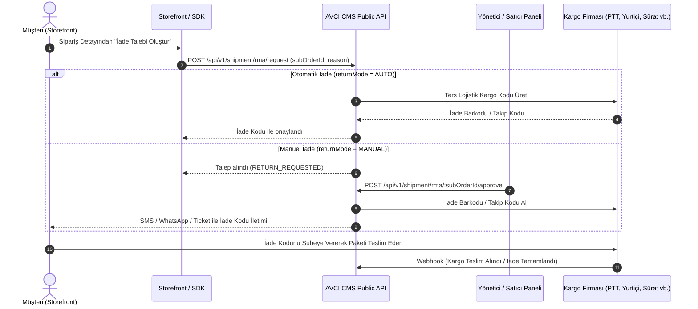

# Müşteri İade Yönetimi (RMA)

AVCI CMS, modern e-ticaret ve pazaryeri operasyonlarında müşteri iadelerini (Return Merchandise Authorization - RMA) **headless ve güvenli** bir mimariyle yönetir.

Son kullanıcılar (müşteriler) yönetim paneline ASLA erişemez. Tüm iade talepleri, Storefront uygulaması üzerinden API ve `@avci/sdk` (TypeScript SDK) aracılığıyla iletilir.

---

## 1. İade Yaşam Döngüsü (Workflow)



---

## 2. Kurallar ve Sınırlar

1. **Dijital Ürün İstisnası:**
   Dijital ürünler (`type: DIGITAL`) Tüketici Hakları mevzuatı gereği iade ve iptal edilemez. Sistem dijital ürün içeren siparişlerde iade talebini `400 BAD_REQUEST` ile reddeder.
2. **Etkinlik & Bilet İade Kuralları:**
   - Etkinlik başlamışsa iade kabul edilmez.
   - Etkinliğe kalan süre `eventPartialRefundHours` (varsayılan 24 saat) altındaysa iade reddedilir.
   - `eventPartialRefundHours` ile `eventFullRefundHours` arasındaysa kısmi iade oranı (`eventPartialRefundRate`, örn. %50) uygulanır.
3. **Kargo Maliyeti:**
   İade gönderilerinde anlaşma bedeli platform veya satıcı hakediş havuzundan karşılanır (`payment: SENDER`). Müşteriden kargo ücreti tahsil edilmez.

---

## 3. TypeScript SDK ile Entegrasyon (`avcicms`)

Storefront uygulamanızda iade akışını başlatmak ve takip etmek için TypeScript SDK'yı kullanabilirsiniz:

### İade Talebi Başlatma

```typescript
import { AvciCMS } from 'avcicms';

const cms = new AvciCMS({
  apiKey: process.env.AVCI_STOREFRONT_API_KEY!,
  clientId: process.env.AVCI_WORKSPACE_ID!,
});

// Müşteri oturumundan gelen subOrderId ile iade talebi:
const response = await cms.shipment.requestReturn({
  subOrderId: 'SUB-2026-98124',
  reason: 'Beden uymadı / Değişim talebi',
  note: 'Paket orijinal kutusunda ve faturasıyla teslim edilecektir.',
});

console.log(response);
```

### İade Durumu ve Kargo Kodunu Sorgulama

```typescript
const status = await cms.shipment.getReturnStatus('SUB-2026-98124');

console.log(status.data.status); // 'RETURNING' | 'RETURN_REQUESTED'
console.log(status.data.returnTrackingNumber); // '98273412344'
console.log(status.data.returnBarcode); // 'TR-RETURN-BARCODE'
```

---

## 4. Yönetim Panelinde İade Onayı

1. Yönetim panelinde **Finans & Lojistik > Siparişler** sayfasına gidin.
2. Durumu `RETURN_REQUESTED` olan alt siparişi (Sub-Order) seçin.
3. Kargo sağlayıcısını (PTT, Sürat, DHL, Yurtiçi vb.) belirleyip **"İadeyi Onayla & Kargo Kodu Üret"** butonuna tıklayın.
4. Sistem otomatik olarak iade kargo barkodunu üretir, müşteri Destek Talebine (`Ticket`) ve bildirim servisine iade kodunu iletir.

