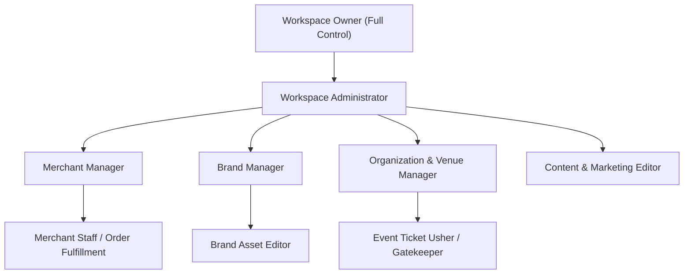

# Authority Hierarchy & Delegation

**Menu Path:** `Workspace > Settings > Authority > Hierarchy`

:::info Permission Requirements
To view and manage the authority hierarchy, you must have the **Workspace Owner** or **Role:Manage** permission.
:::

The **Authority Hierarchy** visualizes and enforces how managerial responsibilities flow across your organization. It ensures that sub-administrators can only assign permissions equal to or below their own authorization level.

---

## The Role Hierarchy Structure

## Key Principles

1. **Principle of Least Privilege:** Team members should only receive the minimum permissions necessary for their specific job functions.
2. **Boundary Protection:** A Merchant Manager can only oversee merchants within their assigned scope and cannot view or alter platform-wide billing or other sellers' finances.
3. **Audit Trails:** All permission changes, role assignments, and token creations are logged with timestamps, IP addresses, and the issuing user's identifier.
