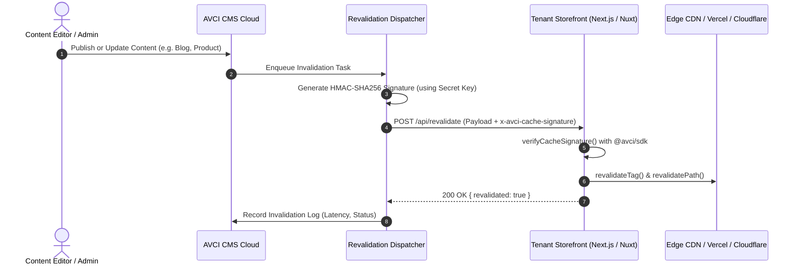

# Storefront Cache & ISR Revalidation

Modern headless storefronts (Next.js App Router, Nuxt 3, Remix, Astro) rely on static generation and Incremental Static Regeneration (ISR) to deliver millisecond page loads.

When an editor or merchant publishes or edits a **Catalog item** (products, events, projects, coupons, campaigns) or **Content item** (blogs, pages, news, dictionaries) in AVCI CMS, your external storefront needs to immediately purge and revalidate its cached pages and data tags.

The **AVCI CMS Cache & Revalidation Service** provides an automated, cryptographic callback system to trigger on-demand cache revalidation in your custom storefront.

:::note Plan Availability
The Cache & ISR Revalidation Callback Service is available for **PRO**, **BUSINESS**, and **ENTERPRISE** workspace plans.
:::

---

## 1. How It Works



---

## 2. Workspace Setup

1. In the AVCI CMS Admin Panel, go to **Workspace Settings > Önbellek & Revalidation** (`/workspace/settings/cache`).
2. Enter your storefront's callback endpoint:
   - Example: `https://my-storefront.com/api/revalidate`
3. Copy the generated **Secret Key** (`crsec_...`).
4. Toggle **"Otomatik Önbellek Temizleme" (Auto Purge on Publish)** to `ON`.
5. Save your settings.
6. Click **"Bağlantıyı Test Et" (Test Connection)** to verify connectivity.

---

## 3. Verifying Callbacks with `@avci/sdk`

Every incoming callback request includes cryptographic headers:
* `x-avcicms-client-id`: The originating workspace ID.
* `x-avci-cache-signature`: Format `t={timestamp},v1={hmac_sha256_hash}`.
* `x-avci-cache-timestamp`: Epoch timestamp in milliseconds.

The official TypeScript SDK (`avcicms`) exports a built-in `verifyCacheSignature` helper that verifies the payload integrity and prevents replay attacks.

```bash
npm install avcicms
```

---

## 4. Drop-in Implementation Examples

### Next.js 15 / 16 (App Router)

Create `app/api/revalidate/route.ts` in your Next.js project:

```typescript
import { NextRequest, NextResponse } from 'next/server';
import { revalidatePath, revalidateTag } from 'next/cache';
import { verifyCacheSignature, type CacheRevalidationPayload } from 'avcicms';

export async function POST(request: NextRequest) {
  const secretKey = process.env.AVCI_CACHE_SECRET;

  if (!secretKey) {
    return NextResponse.json({ message: 'Server secret not configured' }, { status: 500 });
  }

  const rawBody = await request.text();
  const signatureHeader = request.headers.get('x-avci-cache-signature');

  if (!signatureHeader) {
    return NextResponse.json({ message: 'Missing signature header' }, { status: 401 });
  }

  // 1. Cryptographically verify signature and check replay tolerance (5 min window)
  const { valid, reason } = verifyCacheSignature({
    rawBody,
    signatureHeader,
    secretKey,
    toleranceSeconds: 300,
  });

  if (!valid) {
    return NextResponse.json({ message: `Unauthorized: ${reason}` }, { status: 401 });
  }

  const payload: CacheRevalidationPayload = JSON.parse(rawBody);

  // 2. Revalidate specific tags
  if (payload.tags && Array.isArray(payload.tags)) {
    for (const tag of payload.tags) {
      revalidateTag(tag);
    }
  }

  // 3. Revalidate specific paths
  if (payload.paths && Array.isArray(payload.paths)) {
    for (const path of payload.paths) {
      revalidatePath(path);
    }
  }

  return NextResponse.json({
    revalidated: true,
    action: payload.action,
    entity: payload.entity,
    paths: payload.paths,
    tags: payload.tags,
    timestamp: Date.now(),
  });
}
```

---

### Nuxt 3 (Nitro Server Route)

Create `server/api/revalidate.post.ts`:

```typescript
import { defineEventHandler, readRawBody, getHeader, createError } from 'h3';
import { verifyCacheSignature } from 'avcicms';

export default defineEventHandler(async (event) => {
  const config = useRuntimeConfig();
  const secretKey = config.avciCacheSecret;

  const rawBody = await readRawBody(event);
  const signatureHeader = getHeader(event, 'x-avci-cache-signature');

  if (!rawBody || !signatureHeader) {
    throw createError({ statusCode: 400, message: 'Missing payload or signature' });
  }

  const { valid, reason } = verifyCacheSignature({
    rawBody,
    signatureHeader,
    secretKey,
  });

  if (!valid) {
    throw createError({ statusCode: 401, message: `Unauthorized: ${reason}` });
  }

  const payload = JSON.parse(rawBody);

  // Clear Nitro / Nuxt storage or purge cached handlers
  const storage = useStorage('cache');
  if (payload.tags?.includes('*')) {
    await storage.clear();
  }

  return { revalidated: true, event: payload.event };
});
```

---

## 5. Payload Reference

```json
{
  "event": "catalog.product.updated",
  "entity": "product",
  "action": "UPDATED",
  "slug": "ergonomic-standing-desk",
  "id": "673dbf1248...",
  "paths": [
    "/product/ergonomic-standing-desk",
    "/product"
  ],
  "tags": [
    "product",
    "product:ergonomic-standing-desk"
  ],
  "timestamp": 1732095600000
}
```

### Supported Actions:
* `CREATED`: Entity was created and published.
* `UPDATED`: Entity fields, translations, or media were modified.
* `DELETED`: Entity was removed or archived.
* `PURGE_ALL`: Manual full-site cache purge triggered from workspace console.
* `TEST`: Connection ping triggered via "Bağlantıyı Test Et" button.

---

## 6. Monitoring and Logs

You can inspect all historical revalidation callback attempts directly inside **Workspace Settings > Önbellek & Revalidation**:
* **HTTP Status Code:** `200 OK`, `404`, `500`, or network error.
* **Latency:** Duration in milliseconds (e.g. `45ms`).
* **Trigger Details:** Entity type, mutated slug, and target URL.
