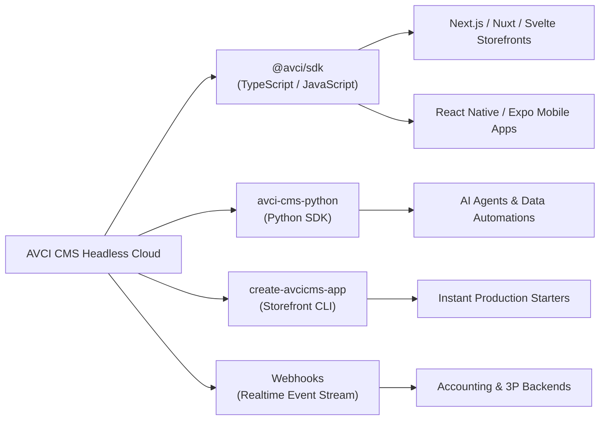

# Developer SDKs & Starter Kits

To accelerate your development workflow and eliminate boilerplate code, AVCI CMS provides official SDKs, command-line starter tools, and webhook subscription systems. 

Whether you are building a custom storefront, a mobile commerce app, or an automated data pipeline, our developer tools provide type-safety, automatic token handling, and robust network retries out of the box.

---

## Available Developer Tools



---

## 1. [TypeScript / JavaScript SDK (`@avci/sdk`)](/sdk/typescript)

The official client library for modern web and mobile applications:
*   **100% Type-Safe:** Automatically generated TypeScript interfaces for products, categories, orders, variants, and cart operations.
*   **Lightweight & Universal:** Built on native `fetch` with zero heavy dependencies; runs seamlessly on Node.js, Cloudflare Workers, Vercel Edge, and browser runtimes.
*   **Automatic Tenant Resolution:** Bundles your Workspace Client ID (`x-avci-client`) into every outgoing request automatically.

```bash
npm install avcicms
# or yarn add avcicms / pnpm add avcicms
```

```typescript
import { AvciCMS } from 'avcicms';

const cms = new AvciCMS({
  apiKey: process.env.AVCI_API_KEY!,
  projectId: process.env.AVCI_PROJECT_ID!,
});

// Fetch active products with full type safety
const products = await cms.content.findMany('products');
```

---

## 2. [Storefront Starter CLI (`create-avcicms-app`)](/sdk/storefront-cli)

Bootstrap a fully functional, production-ready storefront in under 60 seconds:

```bash
npx create-avcicms-app@latest my-storefront
```

The interactive terminal wizard:
1. Prompts for your project name and AVCI Project credentials.
2. Offers curated starter templates:
   *   **B2C Modern Storefront:** Next.js 15, App Router, Tailwind CSS, Cart, Checkout, and Product Pages.
   *   **Event & Ticketing Hub:** Venues, interactive seat maps, and ticket purchasing.
   *   **Content & Editorial:** Multi-language blog, corporate pages, and dynamic contact forms.
3. Automatically sets up `.env.local` and installs all dependencies.

---

## 3. [Python SDK (`avcicms`)](/sdk/python)

Designed for data scientists, inventory synchronization scripts, ERP bridges, and automated AI agents:

```bash
pip install avcicms
```

```python
from avcicms import AvciClient

client = AvciClient(api_key="your_api_key", project_id="your_project_id")

# Retrieve inventory levels
items = client.catalog.list_products(limit=50)
for item in items:
    print(f"{item.name} - Stock: {item.stock_amount}")
```

---

## 4. [Realtime Webhooks](/sdk/webhooks)

Deliver instantaneous HTTP push notifications directly to your external servers whenever critical events occur:
*   `order.created` / `order.paid`
*   `inventory.depleted`
*   `ticket.purchased`
*   `customer.registered`

All webhook payloads are cryptographically signed using HMAC SHA-256 (`x-avci-signature`) to guarantee authenticity.
